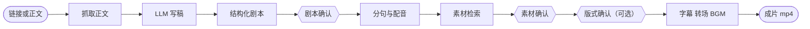

简体中文 | [English](README_EN.md)

<h1 align="center">AI Short Video Engine</h1>

<b>丢一个链接进去，拿到一条能直接发的竖屏短视频。</b>

抓正文 → AI 写稿 → 分句配音 → 匹配素材 → 版式卡 → 烧字幕成片 全流程自动，只在关键节点停下等你点头

  
  
  
  

Windows 免安装 · 自带 ffmpeg · 无需独立显卡 · 默认配音零成本

<a href="#效果示例">效果示例</a> · <a href="#快速开始">快速开始</a> · <a href="#工作流">工作流</a> · <a href="#配置">配置</a> · <a href="docs/faq.md">常见问题</a>

## 效果示例

同一篇 36kr 文章，换一种脚本风格就是完全不同的一条片子。示例经过剪辑压缩，仅展示部分效果。

[📄 示例原文](https://36kr.com/p/3286128054051718) · 播客：两人对谈，信息密度高 · 相声：捧逗互动，包袱密集 · 脱口秀：单人吐槽，只需填主讲角色名

<table>
  <tr>
    <td align="center"><video src="https://github.com/user-attachments/assets/a8a4175d-2ebf-47cc-9c81-8c9a7aa78ae1"></video> <b>播客</b></td>
    <td align="center"><video src="https://github.com/user-attachments/assets/d1819bc3-c909-4ede-927c-57a10f609827"></video> <b>相声</b></td>
    <td align="center"><video src="https://github.com/user-attachments/assets/896de713-e059-4834-b5ca-91a514d89d24"></video> <b>脱口秀</b></td>
  </tr>
</table>

## 为什么是它

「AI 一键成片」的坑从来不在生成，而在**生成完才发现不对**：腔调跑偏、素材不搭，整条片子只能重跑一遍。所以这条流水线在**最贵的节点**插入人工确认——**剧本**（标题与每句台词可直接改，确认后才配音）、**素材**（逐段预览，不顺眼点「换一个」即替换）、**版式**（默认开启，AI 挑模板写文案，逐张改到满意再合成；`CARDS_ENABLED=0` 可关掉这一步）。

其余环节尽量不让你操心：

- **断点续跑**：每个阶段的产物都落盘，中断后重跑只补缺失部分（见[任务产物](docs/artifacts.md)）。
- **配音零成本**：默认 Edge 在线语音，不填 Key 就能出片；需要更好音色再切 CosyVoice 或豆包。
- **成片可重调**：字幕字号、BGM 开关与音量改完点「重新生成」，只重跑合成，配音与素材全部复用。
- **开箱即用**：免安装包内置 ffmpeg / ffprobe，不需要 Node、Python 或任何运行时。

## 快速开始

**1. 拿到程序**：从 [Releases](https://github.com/chenwr727/AI-Short-Video-Engine/releases) 下载 `AI Short Video-x.y.z-win-portable.zip`，解压后双击 `AI Short Video.exe`。约 200 MB，全部自带。数据都落在 exe 同级的 `UserData/`，删目录即彻底卸载。

**2. 填 Key**：首次启动会自动弹出设置页，之后用 `Ctrl+,` 打开。真正必填的只有两样：

| 需要 | 是否必填 | 说明 |
| --- | --- | --- |
| 大模型 | **必填** | 任何 OpenAI 兼容接口：Key + 域名 + 模型名 |
| 素材站 | **至少一个** | Pixabay 或 Pexels，注册即得免费 Key |
| 配音 | 不用填 | 默认 Edge 在线语音，免费；想换音色再填 CosyVoice / 豆包 |

保存后后端自动重启，不必重开应用。

**3. 跑一条**：粘贴网页链接或正文 → 选脚本风格 → 点「开始生成」，之后按页面提示走，每一步都有明确的下一步按钮。

从源码运行、Electron 镜像兜底与提交前自检见 [从源码运行](docs/development.md)。

## 工作流

界面上对应六步（`CARDS_ENABLED=0` 时隐藏版式确认这一步），顶部步骤条可随时点回已完成的步骤回看：

1. **文案脚本** — 粘贴链接或正文，选脚本风格，点「开始生成」
2. **剧本生成** — AI 抓取并写稿后停下，标题与每句台词都能直接改
3. **配音生成** — 按角色选音色、引擎与语速（默认 1.1 倍，`TTS_SPEED` 可改）
4. **素材确认** — 选来源与分辨率后匹配；逐段预览，「换一个」即换候选。此时**不会**自动合成
5. **版式确认** — 点「开始生成版式」才跑；片头 / 章节 / 片尾逐张改文案与时长、换模板、删卡或整份重来
6. **成片预览** — 设字幕字号、BGM 与音量后「生成成片」，之后可改参数再「重新生成」

桌面端点「在文件夹中显示」直接定位成片文件（浏览器里是下载）。

## 配置

界面里通过 **文件 → 设置…**（`Ctrl+,`）填写，保存后自动重启后端生效。除了上面[必填的几项](#快速开始)，其余都有能直接出片的默认值：

| 分组的常用项 | 默认 | 想改时看 |
| --- | --- | --- |
| 画面分辨率 / 帧率 / 语速 | 1080×1920 / 24fps / 1.1 倍 | [配置字段全表](docs/configuration.md) |
| 运镜 / 调色 / 转场 | 6 / 5 / 0.5 秒 | 同上 |
| BGM 与音效 | 开，音量 0.1 / 0.2 | 同上 |
| 片头 / 片尾 / 版式卡 | 关（需 Remotion） | [Remotion 卡片](docs/remotion.md) |
| 剧本审稿阈值 | 0.82 | [环境变量](docs/configuration.md#环境变量) |

配置文件位于免安装版的 `<exe 同级>/UserData/config.json` 或安装版 / 开发态的 `%APPDATA%/aisv-desktop/config.json`。提示词可以直接在应用里改，见[提示词编辑器](docs/prompts.md)。

## 常用命令

| 命令 | 作用 |
| --- | --- |
| `pnpm dev` | 启动桌面应用（先构建 web 与主进程） |
| `pnpm dev:server` / `pnpm dev:web` | 只启动后端 / 只启动前端 |
| `pnpm build:web` | 构建前端产物到 `web/dist` |
| `pnpm typecheck` / `pnpm lint` / `pnpm format` | 类型检查 / ESLint / Prettier |
| `pnpm test` | 运行后端纯函数单元测试 |
| `pnpm dist:win` / `:mac` / `:linux` | 打包免安装 zip / dmg / AppImage |
| `pnpm dist:win:remotion` | 同上，把 Remotion 卡片运行时一起打进包 |

详细的打包体积、瘦身版差异与构建流程见[打包](docs/packaging.md)。

## 更多文档

| 文档 | 内容 |
| --- | --- |
| [从源码运行](docs/development.md) | 依赖、`pnpm dev`、Electron 镜像、提交前自检 |
| [配置](docs/configuration.md) | 全部字段、成片页覆盖项、环境变量 |
| [提示词编辑器](docs/prompts.md) | 改内置提示词、覆盖层机制 |
| [Remotion 卡片](docs/remotion.md) | 片头 / 片尾 / 过场 / 版式确认与自定义 |
| [任务产物](docs/artifacts.md) | 工作区文件清单与断点续跑 |
| [打包](docs/packaging.md) | 体积、卡片运行时、构建流程 |
| [常见问题](docs/faq.md) | 排错、已知限制 |

以上每篇都有英文版（`docs/*_EN.md`）。

## 致谢

`msedge-tts`（在线语音）、`ffmpeg-static` / `ffprobe-static`、Pixabay 与 Pexels 的免费素材 API。

## 许可

仓库暂未附带 `LICENSE` 文件；如需商用或二次分发，请先与作者确认。
