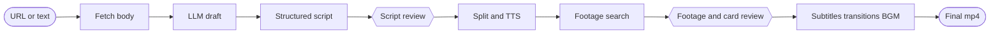

English | [简体中文](README.md)

<h1 align="center">AI Short Video Engine</h1>

<b>Drop in a link, get a vertical short video ready to post.</b>

Fetch article → AI script → per-line dubbing → footage matching → title cards → subtitled final cut Fully automatic, pausing only at the moments that matter

  
  
  
  

Portable on Windows · ffmpeg bundled · no GPU required · free TTS out of the box

<a href="#sample-showcase">Samples</a> · <a href="#quick-start">Quick Start</a> · <a href="#workflow">Workflow</a> · <a href="#configuration">Configuration</a> · <a href="docs/faq_EN.md">FAQ</a>

## Sample Showcase

One 36kr article, one script style swap, a completely different video. Samples are trimmed and compressed to show partial effects only.

[📄 Original article](https://36kr.com/p/3286128054051718) · Podcast: two speakers, information-dense · Crosstalk: fast banter, dense punchlines · Stand-up: solo narration, host name only

<table>
  <tr>
    <td align="center"><video src="https://github.com/user-attachments/assets/a8a4175d-2ebf-47cc-9c81-8c9a7aa78ae1"></video> <b>Podcast</b></td>
    <td align="center"><video src="https://github.com/user-attachments/assets/d1819bc3-c909-4ede-927c-57a10f609827"></video> <b>Crosstalk</b></td>
    <td align="center"><video src="https://github.com/user-attachments/assets/896de713-e059-4834-b5ca-91a514d89d24"></video> <b>Stand-up</b></td>
  </tr>
</table>

## Why This One

The hard part of "one-click AI video" was never generation — it is discovering, after the render, that the tone is off or the footage does not fit, and having to run the whole thing again. So this pipeline puts human checkpoints at **the expensive moments**: **script** (edit the title and any line, confirm, then dub) and **footage and cards** (preview each clip, hit **Replace** to swap in another candidate, then set up intro / chapter / outro cards on the same page before rendering).

Everything else stays out of your way:

- **Resumable**: every stage writes its artifacts to disk, so a rerun only fills in what is missing (see [Task Artifacts](docs/artifacts_EN.md)).
- **Zero-cost TTS**: Edge online voices by default — render a video without entering a single key. Switch to CosyVoice or Doubao for richer voices.
- **Tunable after render**: change subtitle size, BGM on/off or volume and hit **Regenerate** — only composition reruns, all audio and footage are reused.
- **Runs out of the box**: the Windows portable build bundles ffmpeg / ffprobe — no Node, Python, or other runtime needed.

## Quick Start

**1. Get the app**: download `AI Short Video-x.y.z-win-portable.zip` from [Releases](https://github.com/chenwr727/AI-Short-Video-Engine/releases), unzip it, and double-click `AI Short Video.exe`. About 200 MB, everything included. Data lives in `UserData/` next to the exe — delete that folder for a clean uninstall.

**2. Add keys**: the settings dialog opens on first launch; afterwards use `Ctrl+,`. Only two things matter:

| Need | Required | Notes |
| --- | --- | --- |
| LLM | **Yes** | Any OpenAI-compatible endpoint: key + domain + model name |
| Footage | **At least one** | Pixabay or Pexels — free keys on signup |
| TTS | Not needed | Edge online voices are free by default; add CosyVoice / Doubao keys for more voices |

Saving restarts the backend automatically — no need to relaunch the app.

**3. Run one**: paste a URL or article text → pick a script style → click **Start**. Each step tells you exactly what comes next.

For running from source, the Electron mirror fallback and pre-commit checks, see [Run from Source](docs/development_EN.md).

## Workflow

The UI mirrors this in five steps; the step bar at the top lets you revisit completed steps at any time:

1. **Script input** — paste a URL or article text, pick a style, click **Start**
2. **Script generation** — the AI fetches and drafts, then pauses; title and every line are editable
3. **Voice synthesis** — pick a voice per role, engine and speed (default 1.1×, `TTS_SPEED`)
4. **Footage and cards** — choose source and resolution, then match; preview each clip, **Replace** swaps a candidate, and set intro / chapter / outro card durations and copy. Confirming does **not** auto-render
5. **Final preview** — set subtitle size, BGM and volume, then **Render video**; tweak and **Regenerate** afterwards

On desktop, **Show in folder** opens the file location (in a browser it downloads the file).

## Configuration

Fill in the fields via **File → Settings…** (`Ctrl+,`); saving restarts the backend automatically. Apart from the [required items](#quick-start) above, every field already has a workable default:

| Common settings | Default | Where to look |
| --- | --- | --- |
| Resolution / frame rate / speed | 1080×1920 / 24 fps / 1.1× | [Full field reference](docs/configuration_EN.md) |
| Camera motion / grade / transition | 6 / 5 / 0.5s | same page |
| BGM and SFX | on, volumes 0.1 / 0.2 | same page |
| Intro / outro / layout cards | off (needs Remotion) | [Remotion Cards](docs/remotion_EN.md) |
| Script review threshold | 0.82 | [Environment Variables](docs/configuration_EN.md#environment-variables) |

The config file lives at `<next to exe>/UserData/config.json` for the portable build, or `%APPDATA%/aisv-desktop/config.json` for installed / dev runs. Prompts can be edited inside the app — see [Prompt Editor](docs/prompts_EN.md).

## Common Commands

| Command | Purpose |
| --- | --- |
| `pnpm dev` | Start the desktop app (builds web and the main process first) |
| `pnpm dev:server` / `pnpm dev:web` | Backend only / frontend only |
| `pnpm build:web` | Build frontend output into `web/dist` |
| `pnpm typecheck` / `pnpm lint` / `pnpm format` | Typecheck / ESLint / Prettier |
| `pnpm test` | Run backend unit tests for pure functions |
| `git push` | Runs lint / typecheck / format:check first (hook installed by `pnpm install`) |
| `pnpm dist:win` / `:mac` / `:linux` | Build the portable zip / dmg / AppImage |
| `pnpm dist:win:remotion` | Same, bundling the Remotion card runtime |

Archive sizes, the slim variant and the build flow are covered in [Packaging](docs/packaging_EN.md).

## More Docs

| Doc | Contents |
| --- | --- |
| [Run from Source](docs/development_EN.md) | Dependencies, `pnpm dev`, Electron mirror, pre-commit checks |
| [Configuration](docs/configuration_EN.md) | Every field, per-task overrides, environment variables |
| [Prompt Editor](docs/prompts_EN.md) | Editing built-in prompts, how the override layer works |
| [Remotion Cards](docs/remotion_EN.md) | Intro / outro / chapter / card review and restyling |
| [Task Artifacts](docs/artifacts_EN.md) | Workspace file list and resuming |
| [Packaging](docs/packaging_EN.md) | Sizes, card runtimes, build flow |
| [FAQ](docs/faq_EN.md) | Troubleshooting, known limitations |

Every page also has a Chinese version (`docs/*.md`).

## Acknowledgements

`msedge-tts` (online voices), `ffmpeg-static` / `ffprobe-static`, and the free footage APIs from Pixabay and Pexels.

## License

This repository does not currently include a `LICENSE` file; please contact the author before commercial use or redistribution.
